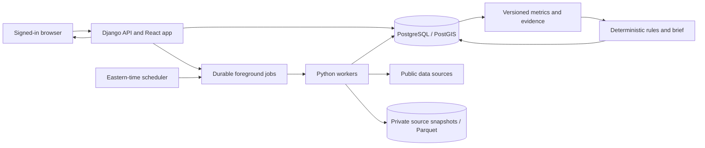

# Paragon Radar — implementation plan for a coding agent

Prepared: November 17, 2026. Target: Release 1 of [AdiY10/Paragon.AI](https://github.com/AdiY10/Paragon.AI).

Repository reviewed at commit `1fee6678716ef24deba5b0ad058fa392ca973be8`. Read: README, AGENTS, CLAUDE, AGENT_HANDOFF, all eight specification documents, the 36-property seed CSV, and both feasibility scripts. The repository contains specifications and probes, not an application. This deliverable is a plan; application implementation, source backfills, account creation, and deployment have not been performed.

**Recommended implementation:** a Python/Django application with a React interface, PostgreSQL/PostGIS, a separate Python worker, and immutable source snapshots. Build a trustworthy data pipeline and one complete property profile before expanding the interface. Release 1 uses deterministic calculations and text templates; it needs no LLM API, vector database, agent orchestration framework, or generated investment advice.

## 1. Contract and completion criteria

Implement a private, invite-only application for Paragon Realty Group with these P0 workflows:

1. This Week: a Monday brief, baseline brief, and immutable archive.
2. Portfolio: 36 unconfirmed seed properties, editable ownership status, tenants, pins, and filters.
3. Location profile: demographics, jobs, economy, housing permits, businesses, traffic, hazards, tenant filings, and evidence.
4. Screen: progressive analysis of any US address or map pin, without adding it to monitoring until saved.
5. Compare: two to four locations using consistent rings, with portfolio median/range and evidence for every cell.
6. Data Sources and Admin: source health, freshness, run logs, manual reruns, invitations, and confirmed SEC mappings.

The source specification remains authoritative: `AGENT_HANDOFF.md` and doc 02 acceptance criteria, then doc 04, then the remaining documents. Record the interpretations below in `docs/DECISIONS.md`; do not silently edit acceptance criteria. If the repository has changed since the reviewed commit, read the diff and reconcile this plan before implementation.

All 25 P0 acceptance criteria must be accounted for. An honest unavailable state is required during a source outage, but does not make a blocked core acceptance test pass. Report separately: implemented, verified, blocked, and deferred.

No production fixtures, inferred ownership confirmations, invented tenants, sample metrics, or benchmark values copied from examples. All seed locations begin Owned + Unconfirmed. Do not import listing demographics, traffic counts, rents, vacancy claims, or occupancy as measured data. P1 work starts only after P0 passes production verification.

## 2. Research findings and decisions to record

These are implementation decisions or corrections, not new product requirements unless explicitly identified.

| Issue | Decision and implementation consequence |
|---|---|
| Overture history expires | The live bucket listing returned September 23 `.0`/`.1` and October 21, 2026 releases. Immediately preserve the newest two distinct monthly releases for all resolved seed pins; use September `.1`, not both September versions, for the historical comparison. Preserve schema, attribution, bridge/changelog metadata, checksums, and extraction manifests. Listing availability does not verify the actual Regal closure fixture. |
| Historical ACS paths differ | Directly substituting `2019` into the 2024 `table-based-SF` path returned 404. Census links to [`2019/prototype/5YRData/`](https://www2.census.gov/programs-surveys/acs/summary_file/2019/prototype/5YRData/). Discover filenames and headers from that directory; keep a sequence-file parser fallback. The agent must verify all five historical tables before committing to an importer. |
| Reference counts use different methods | The documented 3-mile reference used block-group internal points; the 1-mile reference used 2020 block counts. Neither is a completed regression test of the required weighted ACS algorithm. Implement the required method, run AC-06 with its ±10% bounds, and investigate discrepancies. Never tune weights to force the reference answer. |
| Benchmark membership conflicts | AC-12 and the empty-state copy require confirmed properties. Use **confirmed, non-archived Owned** locations only; require at least five eligible values per metric. Unconfirmed properties remain monitored but never silently enter the benchmark. |
| Ratio/proportion MOE typo | Doc 04 reverses the negative-radicand fallback. Use the plus formula for ratios; for subset proportions use the minus formula, falling back to plus when negative. Document the correction against [Census derived-estimate guidance](https://www.census.gov/content/dam/Census/library/publications/2018/acs/acs_general_handbook_2018_ch08.pdf). |
| Connecticut geography | Treat geography identifiers as versioned. Use official relationship files and spatial validation to connect 2020 legacy blocks to current ACS groups. Never replace county digits mechanically. Economic trends require the same published geography code. [Census relationship files](https://www.census.gov/geographies/reference-files/time-series/geo/relationship-files.2022.html). |
| Old SEC events may leave `recent` | Read submissions history files as well as `filings.recent` to supply five years of events. The SEC documents additional historical files explicitly. [SEC submissions API](https://www.sec.gov/search-filings/edgar-application-programming-interfaces). |
| Nominatim and confidential candidates | Its public policy prohibits confidential material, autocomplete, and systematic queries. Allow public-address fallback only after a deliberate deployment configuration acknowledging the policy; globally throttle to ≤1 request/s, identify the app, cache, and make the endpoint replaceable. Route confidential candidate fallback to manual pin by default, or an approved provider with suitable terms. This follows the allowed fallback-provider choice in the handoff. [Nominatim policy](https://operations.osmfoundation.org/policies/nominatim/). |
| FYI versus attention | Property attention is High if any High signal, Watch if any Watch signal, otherwise Clear. FYI remains visible but does not introduce a fourth attention level. Clear must say “No active High/Watch signals”; if coverage is incomplete, show that alongside it. |
| First brief and event age | First brief is “Baseline: current conditions.” SEC expiry is based on filing date, not ingestion date. Overture map events use release publication date as the observation date and never claim an actual business closure date. |
| Pin changes and asynchronous work | Every computation carries a location revision. Results from an older revision cannot overwrite the new pin's profile. Old geography-based signals resolve as “location corrected”; failed sources must not masquerade as conditions clearing. |
| Broad Overture change guard | Compute the guard over a completed, comparable release cohort before publishing closure/opening signals. A partial failed download cannot create mass closures. Missing/low-confidence replacement records need an explicit quality state, not fabricated disappearance evidence. |
| Flood “at pin” terminology | The specification's ±30 m envelope is a screening area, not exact parcel containment. Label the method visibly, retain intersecting zones, and use the required highest-risk screening result. Store BFE with its unit and vertical datum; missing or sentinel BFE is not zero. |
| Better/worse highlighting | Apply directional labels only to eligible, same-period values. For ACS level comparisons, use a documented difference-significance guard; trends already require significance. Non-survey data can be highlighted when it crosses the specified portfolio quartile boundary, described as a relative comparison, not statistical proof. |
| National screening versus portfolio-only caching | Preloading 12 states alone cannot establish the “any US address” performance target. Prepare nationwide compact reference assets and test cold screens outside portfolio states. Coverage and cost/performance must pass an early feasibility gate. |
| Delivery ambiguity | Deploy the authenticated skeleton in M0, following the handoff. Do not interpret doc 07's “from M1” wording as permission to postpone hosting validation. |

Additional interpretations: comparisons default to 1/3/5 miles and allow 3/5/10; compute all requested rings for every column without changing each property's saved preset. Portfolio range means min–max, with n shown. Owned locations include themselves in the specified percentile distribution. Ties use midrank. Censored median incomes such as “≥ $200,000” are not exact numeric ranks. Stale/cached results remain visible, but no new positive or negative signal is inferred merely from a failed refresh.

## 3. Architecture

Use a modular monolith. Keep ingestion and computation outside HTTP request execution.

| Layer | Choice | Reason |
|---|---|---|
| Runtime/API | Python 3.12, latest patched Django 5.2 LTS, Django REST Framework | One language for geospatial/statistical work and backend; mature migrations, authorization, admin, and sessions. [Django 5.2 support](https://docs.djangoproject.com/en/5.2/releases/5.2/). |
| Interface | React + TypeScript + Vite, Tailwind, accessible Radix/shadcn components, TanStack Query | Map-oriented UI with progressive sections and a shared evidence drawer. Pin compatible stable versions in lockfiles at M0. |
| Maps | MapLibre GL JS; configurable raster/vector tile source | Interactive rings, clusters, pin editing, consistent attribution. OSM standard tiles are acceptable only for this low-volume pilot under their policy; no prefetch/offline download, preserve browser caching and origin Referer. [Tile policy](https://operations.osmfoundation.org/policies/tiles/). |
| Database | PostgreSQL + PostGIS, Django ORM/GeoDjango | Transactional application state, geography indexes, source metadata, observations, and signal history. |
| Bulk/analytical processing | DuckDB, PyArrow, Shapely/pyproj where needed | Stream CSV/Parquet and query bounded source subsets; avoid loading national datasets into pandas memory. [DuckDB Parquet support](https://www.duckdb.org/docs/current/data/parquet/overview). |
| Queue | Django-Q2 with PostgreSQL ORM broker | Durable small-team jobs without a separate Redis service. Separate foreground and maintenance queues. Receipt retry duration must exceed task timeout. [Queue configuration](https://django-q2.readthedocs.io/en/master/configure.html). |
| Scheduling | One application scheduler process using `zoneinfo`, persisted due times, and DB lock | Compute the next wall-clock occurrence in `America/New_York`; enqueue durable tasks. Do not rely on UTC-only recurrence to preserve 07:00 through DST. |
| Authentication | django-allauth with Google/Microsoft OIDC and server sessions | Invite allowlist, no custom password storage, no email-delivery dependency for the pilot. Use the provider supported by the deployment owner. [OIDC integration](https://docs.allauth.org/en/latest/socialaccount/providers/openid_connect.html). |
| Storage | Private S3-compatible object storage plus bounded worker scratch disk | Raw responses, retained Overture extracts, compact national assets, manifests, and backups. Persist durable artifacts before marking a job successful. |
| Hosting | Render Docker web service + background worker + managed Postgres; existing approved object storage | Suitable long-running workers and managed HTTPS; PostGIS is supported. Cost approval is a deployment prerequisite, not assumed. [Render extensions](https://render.com/docs/postgresql-extensions). |
| Verification | pytest/pytest-django, Hypothesis for mathematical invariants, Vitest, Playwright, axe | Test numerical correctness, state transitions, authorization, and the actual workflows. |



Build the React bundle into the Django deployment and serve application pages on one origin. Auth callbacks and generic static assets may be public; no public HTML embeds portfolio data. All business APIs, GeoJSON, evidence, screen results, object downloads, and admin operations enforce server-side authorization. Do not expose the raw object bucket or direct database credentials to the browser.

The UI polls the build-status endpoint every 1–2 seconds while active, with backoff. SSE is optional after P0. Do not add a websocket system solely for progressive loading.

## 4. Repository layout and interfaces

Preserve the existing specifications and probes. Add:

```text
backend/
  manage.py
  config/                    settings, URLs, security, runtime startup
  apps/
    accounts/                invitations, memberships, sessions, audit
    locations/               locations, revisions, tenants, screen drafts
    geography/               rings, geographic assets, relationships
    sources/                 registry, adapters, snapshots, health
    metrics/                 pure calculations, observation publication
    signals/                 rule evaluators, evidence, lifecycle
    briefs/                  composition, archive, schedule cursors
    operations/              queues, jobs, scheduler, admin status
  tests/{unit,integration,contracts}/
frontend/src/
  routes/                    brief, portfolio, profile, screen, compare, sources, admin
  components/                MetricValue, EvidenceDrawer, SourceBadge, maps
  api/                       generated OpenAPI types and query hooks
config/
  sources.yaml
  metrics.yaml
  signals.yaml
  category_groups.yaml
  brand_aliases.yaml
  schedules.yaml
data/manifests/              source URLs, hashes, schemas; no secrets
tests/fixtures/real/         small public responses with capture manifests
tests/e2e/
infra/                      Dockerfile, compose.yaml, render.yaml
docs/                       DECISIONS, DATA_METHODS, DEPLOYMENT, reports
progress.md
Makefile
.env.example
```

Keep calculations in pure functions; source adapters only discover/fetch/parse/validate. API handlers orchestrate domain services; React never computes authoritative metrics or signals. Config files carry schema versions. Every metric ID and signal ID from doc 04 must appear in the registry and contract tests.

Minimum adapter contract:

```python
class SourceAdapter(Protocol):
    def discover(self, context) -> ReleaseManifest: ...
    def fetch(self, request) -> RawArtifact: ...
    def normalize(self, artifact) -> NormalizedBatch: ...
    def validate(self, batch) -> ValidationReport: ...
```

An adapter uses a shared HTTP client with host allowlists, explicit timeouts, retries, rate limits, response-size bounds, and sanitized diagnostics. Check both HTTP status and source-level JSON errors. ArcGIS services may return errors inside HTTP 200 responses. Paginate by object IDs or supported pagination until complete; honor `exceededTransferLimit`.

## 5. Data model and invariants

Use UUIDs for app identifiers, UTC timestamps for storage, and explicit period fields instead of deriving periods from ingestion time.

| Entity | Required contents / constraints |
|---|---|
| Membership / Invitation | Normalized invited email, Admin/Member, active flag, issuer and dates. Verify provider email before matching; check active membership on every request. |
| Location | Owned/Candidate/Archived, confirmation status, seed ID, public source URL, name/address, type, preset, optional GLA, notes, current revision. Unique seed ID; repeat seed import cannot overwrite edits. |
| LocationRevision | Immutable coordinates, pin method, matched address, pin confirmation, actor, timestamp, geography resolver version. Coordinate changes atomically advance revision. |
| ScreenDraft | Creator, confidential flag, expiry, location-like revision/build reference. No scheduled monitoring; proposed TTL seven days. Saving promotes the same result to Candidate atomically. |
| Tenant / TenantFilerMapping | Location, brand, anchor, confirmed flag, source, suggested versus confirmed CIK, approver. Brand and legal parent remain distinct. |
| SourceDefinition | SRC ID, coverage, licence, attribution, endpoints, periods, cadence, stale thresholds, privacy disclosures, adapter version. Include SRC-15/16 as user/seed provenance. |
| SourceSnapshot / Artifact | Source, release/period, source URL, retrieval time, publication/effective date when known, schema, SHA-256, private artifact URI, revision, completeness. Immutable; failed staging is never the current snapshot. |
| SourceCheck / SourceHealth | Last attempt, last successful check, latest available release, latest processed release, incidents and consecutive failures. Health also scoped to region/geography so one successful county does not mask another failing county. |
| GeographyAsset | Geography kind, vintage, GEOID, point/geometry, block population/land area, full block-group denominators, parent relationships, provenance. Preserve legacy and current CT identifiers separately. |
| MetricObservation | Metric ID, value/bounds, units, nature label, ring/geography, source period, revision, MOE/reliability, missing reason, method version, evidence ID. Unique by logical inputs and computation version. |
| Evidence | Definition, formula/method, exact coordinates, inputs and snapshots, source-record identifiers/links, data period, check time, uncertainty, caveats. Immutable derivation record. |
| PlaceSnapshot | Release + GERS ID, source attribution, raw and normalized brand/category, status, confidence, coordinates; location membership and distance computed per revision. |
| Filing | CIK + accession unique, form, item set, filing date, document/index URLs, source snapshot. Store five-year history where available. |
| Signal / SignalEvent | Rule, location, subject, severity, direction, active/resolved/expired state, detected/event/expiry dates, frozen evidence, rule version. Append transitions instead of overwriting history. |
| Brief / BriefItem | Local scheduled date, baseline/manual/weekly type, generation cutoff, previous cursor, immutable items and source-update list. Unique scheduled weekly key prevents duplicate briefs. |
| JobRun / Schedule | Job type, scope, dedup key, attempt, timestamps, heartbeat, progress, records, warnings, sanitized error, next due time. |
| AuditEvent | Who changed ownership, tenants, pins, roles, mappings, and settings; before/after references. |

An API metric envelope must include `metric_id`, `value` or `bounds`, `unit`, `nature`, `data_period`, `geography`, `location_revision`, `method_version`, `evidence_id`, `last_checked_at`, `availability`, `freshness`, and `reliability`. These are independent dimensions: a valid cached value can be stale after a source error. Never encode all states in one boolean.

The frontend's `MetricValue` component accepts this envelope, not an isolated number. Evidence validation covers derived counts as well: brief counts derive from stored signals; portfolio counts derive from database records. GLA and other user values identify who entered them and when.

Store exact values for computation; round only for presentation. Missing values are null with reason codes from doc 04, never zero. Add internal diagnostic detail without replacing the specified user-facing reason taxonomy.

## 6. Geography and calculation implementation

### Rings and ACS

1. Convert miles using `1609.344` metres. Use an indexed spherical distance query, consistently with the specified great-circle method; in PostGIS geography queries this requires deliberate handling of `use_spheroid=false`. Record the implementation and boundary convention (`distance <= radius`). [PostGIS distance semantics](https://postgis.net/docs/ST_DWithin.html).
2. Retrieve every relevant block across state/county boundaries. A 10-mile ring is not restricted to the pin's state. Resolve addresses, county equivalents, places, and county subdivisions separately.
3. For each vintage, assign blocks to that vintage's ACS block groups through verified relationships. Current Census geocoder codes are not a universal join key for historical data.
4. Weight group estimates using in-ring block population divided by **all** block population in that group. Store full denominators even when downloading spatial subsets. Clipping the denominator to the ring is a serious overcounting bug.
5. For zero-population groups, use actual land-area overlap. Load required block/land geometry; do not substitute block centroid inclusion. If land geometry is unavailable, fail the affected derived result visibly.
6. Ingest population, households, aggregate income, all income brackets, and education counts plus MOEs from B01003, B11001, B19025, B19001, B15003. Preserve ACS annotation/sentinel semantics. Do not coerce negative sentinel codes into real estimates or zero. If a required contributing group/cell is missing or suppressed, do not publish a partial sum as a complete ring total: return the relevant unavailable reason and coverage diagnostics. Apply this guard independently per metric.
7. Calculate weighted counts and squared-weight MOE sums. Calculate mean income from weighted aggregate income / weighted households; never average group means or medians.
8. Interpolate median income from weighted bracket counts. Preserve top-censoring as a lower bound. Do not invent a midpoint for the open top bracket. Record the approximation for the lowest open bracket too; return a bound if it cannot support the documented interpolation.
9. For mean income, `MOE = sqrt(MOE_num² + R² * MOE_den²) / den`. For an education proportion, use the subset-proportion formula and ratio fallback per the decision above; scale proportion and MOE to percentage together.
10. Compare 2015–2019 and 2020–2024 initially. Later vintage discovery must select non-overlapping windows and a verified geography mapping. [Census comparison guidance](https://www.census.gov/programs-surveys/acs/guidance/comparing-acs-data.html).
11. Apply the annual inflation factor to both earlier income and MOE. Prefer the BLS R-CPI-U-RS annual table, validating the published correction/version; explicitly label CPI-U if the documented fallback is needed. [BLS research series](https://www.bls.gov/cpi/research-series/r-cpi-u-rs-home.htm).
12. Implement doc 04's Z test and CV thresholds without rounding before decisions. Zero denominators, missing MOEs, zero SEs, and censored inputs need explicit cases. Reject comparisons with missing required inputs. The MOE is an approximation and does not capture all allocation error; show that caveat.

### National assets and performance gate

Use nationwide compact Parquet assets for ACS and block internal points/population, spatially partitioned so a screen reads only intersecting partitions. Keep block-group denominators and versioned relationships in compact lookup assets. Retain only hot geography subsets and materialized observations in Postgres. Build nationwide LODES partitions for available state-years before final national screening verification; missing published coverage is an honest source gap.

Start by proving three seed sites and one address outside all portfolio states. Measure cold artifact reads, not just cached SQL. If a new screen must download an entire state's shapefile or WAC gzip, the design has not yet met the latency target. If national preprocessing is too expensive on the proposed tier, prepare the assets once using an authorized build environment, then publish compact artifacts. Do not declare the requirement met by silently narrowing coverage to 12 states.

## 7. Source implementation work packages

Each adapter must provide a successful real capture, a missing/suppressed case where applicable, timeout/schema-failure tests, an idempotency test, a manifest, and visible provenance. Doc 03 supplies endpoint examples; endpoints and layer IDs must be checked against service metadata.

| Sources | Work package and non-obvious checks |
|---|---|
| SRC-01/02 geocoders | Submit-based Census lookup; handle exact, non-exact, tie, and no-match. Use stored seed reference coordinates as explicitly attributed unconfirmed references, not as newly verified geocodes. Public fallback obeys the policy decision; manual pin always works. Spatially resolve geography after manual/fallback coordinates. |
| SRC-03/04 ACS + geography | Current and historical bulk adapters; discover 2019 prototype filenames separately. Stream table rows, retain estimate/MOE pairs, and ingest 2010/2020 block population and geography relationships. Confirm TIGER products actually include population; ordinary boundary files alone are insufficient. Paginate REST fallbacks. |
| SRC-05 LODES | Discover latest two available comparable years **per state**; parse WAC `S000_JT00`. Sum C000, CNS07, CNS18 by block internal-point location. Handle legacy CT block IDs correctly. Both total-job years must have ≥1,000 jobs for trend. Label noise protection; never display block-level counts. |
| SRC-06 QCEW | Parse by column names, `own_code=5`, total industry `10`, retail `44-45`, and correct aggregation level. Get latest and same quarter one year earlier; suppressed inputs stay suppressed. Preserve published/revised observations and avoid mixing quarter-vintage revisions. |
| SRC-07 LAUS | Discover/validate series IDs against BLS metadata; use latest normal monthly period and same month prior year. Preserve preliminary footnotes. Batch and cache requests; enforce API-version budgets globally. Weekly checks also detect revisions to existing periods, not only new months. [BLS API capabilities](https://www.bls.gov/bls/api_features.htm). |
| SRC-08 inflation | Retrieve and validate 2019/2024 annual indices, source revision, and ratio; the research series was not separately verified by the original repo. Use one index consistently for both dates. |
| SRC-09 BPS | Ingest 24 complete months of unit estimates, not building counts. County `C` files are current-month values; `Y` files are cumulative and must not be summed as months. For places, process revised monthly cumulative records keyed by jurisdiction and month. Resolve New England MCD/town codes. Missing months invalidate TTM; a zero prior total cannot produce an invented percentage. [County layout](https://www2.census.gov/econ/bps/Documentation/cntyasc.pdf), [place layout](https://www.census.gov/construction/bps/sample/placeasc.pdf). |
| SRC-10 HPMS | Discover state/year services; query geometry within 250 m, fetch route IDs and segment begin/end measures, then choose up to two distinct named routes by functional class and AADT. No trend across changed segments. Interpret field-specific missing codes; do not automatically treat every AADT zero as a real traffic count. |
| SRC-11 NFHL | Query the specified small and 100 m envelopes; preserve all intersecting zones, effective map identifier, units/datum, source citation, and checked date. Highest-risk result is conservative screening. Coverage detection must distinguish no digital map from a covered zone X; an empty layer result is not proof of no hazard. Cache per revision; a moved pin never receives the old pin's flood value. |
| SRC-12 NRI | Read metadata, spatially locate the tract, capture rating/percentile and top three hazards plus NRI version. No unverified join to current tract ID. Keep modelled tract context distinct from flood-zone determination. |
| SRC-13 Overture | Discover available releases, validate schemas, query only necessary columns using bbox pushdown, then exact 3-mile distance filtering. Store unfiltered statuses and source attribution before deriving counts. Normalize categories and brand aliases through versioned config. Retain the required historical extracts permanently for reproducibility. |
| SRC-14 SEC | Validate `SEC_USER_AGENT` includes a real supplied contact; use ≤5 requests/s across workers. Load confirmed CIK mappings, filer name/ticker search, recent filings plus historical files. Normalize 8-K/8-K amendments without duplicate accession events; match item tokens exactly. Store document and index links. Private/unmapped tenants are not covered, not healthy by default. |
| SRC-15/16 user/seed | Idempotent CSV import, 36 rows, unique seed IDs, public provenance. Preserve uncertain listing wording. A list saying “Join” or “nearby retailers” must not become confirmed current tenancy. Suggested anchors/mappings remain unconfirmed. |

For Overture, `confidence` is an existence signal, not a probability that a closure is true. Retain null-confidence records for inspection but exclude them from threshold-based counts/signals until policy is explicit; null operating status remains present as required. Temporarily closed records remain counted under the specified exclusion rule, with their status visible. Preserve bridge/changelog information to explain re-identifications. [Overture Places guide](https://docs.overturemaps.org/guides/places/), [attribution](https://docs.overturemaps.org/attribution/).

## 8. Jobs, publication, and recovery

Use these steps for every source update:

1. Acquire a scope-specific lock; create a run with deterministic deduplication key.
2. Discover release/period and fetch raw artifacts with checksums.
3. Normalize into staging; validate schema, geography, completeness, ranges, and record-count changes.
4. Persist artifacts and publish a successful source snapshot transactionally.
5. Enqueue affected metric computations with source snapshot IDs and location revision.
6. Publish consistent metric bundles; reject obsolete revision results.
7. Evaluate dependent rules and recompute benchmark summaries using an explicit cohort/version.
8. Update run/source health and append change events.

Three attempts with exponential backoff and jitter. Respect Retry-After; do not retry an invalid schema as if it were a transient timeout. Every task has a timeout, heartbeat, bounded scratch space, and recovery behavior. Queue delivery is at-least-once; correctness comes from idempotent writes and unique keys, not assuming exactly-once execution.

Separate interactive work from maintenance. Chunk Overture and national ingestion by bounded partitions/location groups so one bulk task does not block a screen for 30 minutes. Start with one heavy DuckDB task at a time; reserve capacity for short interactive calculations. Test memory, connections, and queue delay on the actual host.

| Job | America/New_York schedule | Implementation notes |
|---|---|---|
| `sec_daily` | Daily 06:00 | Deduplicate CIK fetches, fan out events to matching properties, expire old event signals. |
| `brief_weekly` | Monday 07:00 | Use available completed data at cutoff; expose any delayed source checks. |
| `overture_check` | Thursday 03:00 | Check even if unchanged; snapshot new releases; stage whole cohort before artifact guard. |
| `bls_bps_check` | Tuesday 05:00 | Discover new periods and revisions; batch geography queries. |
| `annual_sources_check` | First of month 04:00 | Check ACS/LODES/HPMS/NRI/CPI; dispatch bounded ingestion tasks. |
| `flood_recheck` | 15th of month 04:00 | Chosen time fills the specification's unspecified hour. |
| `maintenance_daily` | Daily 05:30 | Expire 90-day signals and seven-day screen drafts; audit stale sources. |
| `backup_daily` | Daily 02:00 | Encrypted logical backup to separate private storage; retain at least seven days. |

Use a singleton scheduler with durable occurrence keys. On restart, coalesce missed source checks into one run, retain the missed-schedule audit, and generate an explicitly late brief if needed. Do not generate duplicate weekly briefs. Test both DST transitions: a nonexistent spring-forward time runs at the next valid local time, and a repeated fall-back occurrence runs only once. Manual briefs do not advance the scheduled weekly cursor; give them their own generation history.

Source freshness follows doc 04 exactly: SEC 3 days; Overture 21 days or new release unprocessed >14 days; LAUS/BPS/QCEW 21 days; ACS/LODES/HPMS/NRI/CPI/NFHL 45 days. Assign SRC-04 a 45-day metadata/check policy as an explicit missing default. Annual period age is not itself a failed check. An unchanged successful check advances last-checked, not data-period.

Keep the last successful value on source failure. A previous pin's value is historical, not a valid cached fallback for a new pin. Alert after two consecutive failures or stale status through an approved hosting alert channel. The system status page always provides the same incident record.

Provide `rebuild_derived` to rebuild metrics/signals from stored snapshots without redownloading; exclude immutable past brief contents from rewriting. Verify backup restoration to an isolated database. Render Hobby PITR is only three days, so it does not by itself satisfy seven-day daily-backup retention. [Backup documentation](https://render.com/docs/postgresql-backups).

## 9. Signals, benchmarks, and evidence summaries

Implement `evaluate(rule, observations, previous_state, now, config)` as a pure function returning decisions and evidence. Storage/lifecycle handling is separate. Transcribe all thresholds and text templates from doc 04 into versioned configuration; do not substitute model judgment.

| Rule | Required behavior |
|---|---|
| SIG-01 | Significant 3-mile population change: ≤−3% Watch; ≥+3% FYI. |
| SIG-02 | Significant real mean-income change: ≤−5% Watch; ≥+5% FYI. |
| SIG-03 | County private jobs YoY ≤−2% Watch; ≥+3% FYI. |
| SIG-04 | County retail jobs YoY ≤−4% Watch. |
| SIG-05 | Unemployment YoY rise ≥1 percentage point Watch; revisions can resolve it. |
| SIG-06 | 3-mile jobs YoY ≤−5% Watch; ≥+5% FYI, both years ≥1,000. |
| SIG-07 | TTM units change ≥25% and ≥50 units, or ≤−25% and ≤−50 units: FYI, with direction. |
| SIG-08 | Same-segment AADT change ≤−10% Watch; ≥+10% FYI. |
| SIG-09 | Qualified explicit closure or disappearance: distance/category/brand eligibility, own-tenant match within 150 m, severity downgrade for disappearance, global release guard. Always “Possible … verify.” |
| SIG-10 | New key-category GERS ID within 3 miles, confidence ≥0.8, not closed: FYI; bridge-aware and artifact-guarded. |
| SIG-11 | SFHA in pin screening envelope High; only nearby Watch; changed at-pin zone High per specification, with change direction explained. |
| SIG-12 | Confirmed filer mapping, Item 1.03 in last 90 days: High at every mapped property's tenant. |
| SIG-13 | Confirmed mapping, Item 2.05 or 2.06 in last 90 days: Watch. |

For SIG-09 implement a documented severity ladder `High → Watch → FYI`, with disappearance downgrade floored at FYI. Determine true presence/absence from complete raw snapshots, not filtered counts. Re-identification and confidence drop are not equivalent to disappearance. The artifact-guard denominator includes only locations successfully captured in both releases at the same pin revision; incomplete coverage keeps the guard provisional and prevents publishing unguarded change signals.

Time-series signals use a stable logical subject plus append-only evaluation events; superseding periods resolve/replace prior active observations according to each rule. Event signals use accession or bridged place identity. Idempotent reruns must not reset `detected_at` or extend expiry. Pin corrections and tenant mapping changes explicitly retire inapplicable active signals.

Portfolio percentile is `100 * (less_count + 0.5 * equal_count) / n`. Require same metric, ring, units, period, method version, and usable value; exclude suppressed/censored/very-low-reliability values. Show n and exclusions. For county metrics the cohort remains properties as specified, so shared counties repeat; disclose the number of distinct counties as context. Use the same cohort for percentile, median, and range. Confirmation, archive, pin, or source changes invalidate cached benchmarks.

Generate at most five strengths and five concerns using doc 04's rules. Deduplicate a hazard concern and its equivalent signal so one issue does not occupy two slots. Sort hazards/High first, then percentile distance from 50; preserve evidence links and factual wording. With insufficient portfolio n, show only supported hazard/signal findings and the benchmark requirement.

Brief composition is owned-only: new or increased-severity signals since its prior scheduled cutoff, plus still-active High signals, deduplicated. Rank by severity, category, detection time, property name, then stable ID. Collapse FYI. Source updates mean data-period advances, with revisions identified separately. Do not promote a historical filing into a weekly event merely because a CIK was mapped today.

## 10. API and user-interface contracts

| API group | Operations |
|---|---|
| `/api/session`, `/api/admin/users` | Current member; invite, remove, role changes. Reject Member admin actions; removing a member denies their next request. |
| `/api/locations` | List/filter/search, create/update, confirm/archive; revisions and tenants. |
| `/api/locations/{id}/pin` | Submit new pin with expected revision; return conflict for concurrent edits, otherwise enqueue rebuild. |
| `/api/screens` | Create draft from address/pin; build status and partial profile; save as Candidate. |
| `/api/profiles/{id}` | Revision-aware section envelopes and per-source progress. |
| `/api/compare` | Validate 2–4 accessible locations/drafts, common ring preset, per-cell evidence and benchmark cohort. |
| `/api/evidence/{id}` | Full derivation and supporting source records, with authorization inherited from parent data. |
| `/api/briefs` | Current and archived briefs; admin generation endpoint. |
| `/api/sources`, `/api/admin/jobs` | Health/licence/freshness; run log and allowed reruns. |
| `/api/admin/filers` | Search filer names/tickers, inspect suggestions, confirm/unmap CIK associations. |

Use idempotency keys for candidate saves, reruns, and manual brief creation; optimistic concurrency for editable records. Address text is request-body data, not a browser URL parameter. Screen drafts are private to their creator until saved, unless an explicit team-sharing policy is adopted. Saved candidates follow the repository's team-access model.

Build a consistent product interface: restrained typography, legible tables, generous spacing, a map/list split on desktop, meaningful empty states, and textual severity labels. Evidence should be one click from every metric and sentence. Avoid dashboard filler charts.

Implement screens in this order:

1. Sign-in and first-run confirmation list.
2. One real profile with map, ring switch, evidence drawer, and source badges.
3. Portfolio map/list with synchronized filters and global search.
4. Full profile sections in the exact FR-08 order.
5. Data Sources and Admin operations.
6. This Week and archive.
7. Screen and Compare with consistent periods/rings.

Pin dragging requires confirmation, immediately shows the new revision's loading state, and offers a keyboard-accessible coordinate entry alternative. Maps have corresponding lists. “No material changes” and “benchmark needs five confirmed properties” are legitimate first-run states. Never auto-confirm properties to make the demo look populated.

## 11. Execution backlog and milestone exit gates

Each numbered task should be a small reviewable commit. Update `progress.md` after each task with evidence, next task, and blockers. Implement the command names below as tooling contracts; they do not exist in the starting repository.

### M0 — foundations and immediate preservation

**Dependencies:** repository access; deployment credentials for live M0. Local work and snapshot preservation can proceed while deployment access is pending.

1. Record source commit, read updated instructions, create `docs/DECISIONS.md`, `progress.md`, and a complete AC traceability table.
2. Add a resumable `snapshot_overture_bootstrap` command using resolved seed pins; preserve the two monthly releases and capture Kingston's real historical fixture. Flag unresolved Mt. Kisco pin; never guess. Do this before UI work and before lengthy national imports.
3. Scaffold Django/React/PostGIS, dependency lockfiles, Docker Compose, CI, `.env.example`, OpenAPI generation, and health checks.
4. Implement allauth login, invitations/roles, verified-email matching, membership revocation, and no-public-signup guards. Invite by allowlist plus shareable sign-in URL initially; email delivery is not required for P0.
5. Add queue, source registry, source/job logs, snapshot storage, and scheduler skeleton.
6. Prepare `render.yaml`, resource budget, and secure deployment instructions. Deploy the authenticated shell when the owner-provided account/cost approval exists.

**Exit:** AC-01/02; no unauthenticated data; revoked session denied next request; real HTTPS shell; Overture capture manifest or explicit unrecoverable-history blocker. Local success alone does not pass live M0.

### M1 — locations, geography, and a real vertical slice

**Depends on:** M0.

1. Models/migrations for locations, revisions, tenants, evidence, artifacts, and observations.
2. Idempotent 36-row seed, cautious tenant normalization, public-source provenance, and confirmation/archive/edit endpoints.
3. Census lookup, compliant fallback/manual pin, geographic resolution, and pin-revision invalidation.
4. ACS 2019/2024 importers and 2010/2020 block assets/relationships; CPI retrieval; pure ring/statistical functions.
5. Compute a sourced Staples Plaza profile with evidence and uncertainty. Test Kingston fallback and Cypress Lake geography.
6. Run the national cold-screen architecture spike, recording asset sizes, memory, latency, and estimated host cost. Resolve it before scaling ingestion.

**Exit:** AC-03–07; reference V1/V4 and AC-06 bounds; complete denominator and CT mapping tests; old-revision task cannot overwrite new result. Statistical/geometry correctness is a hard gate before UI expansion.

### M2 — complete source integration

**Depends on:** M1, preserved Overture history. SEC requires the supplied contact identity.

1. Add QCEW/LAUS/CPI/BPS and version/revision discovery.
2. Add LODES with state coverage manifest, nationwide available-year assets, and cross-state rings.
3. Add HPMS, NFHL, NRI with error/coverage distinctions.
4. Complete Overture ingestion, category/brand configs, bridges, monthly diffs, and broad-change preflight.
5. Add SEC registry search, explicit mapping confirmation, five-year backfill, and daily refresh.
6. Add source-specific health/freshness, retries, alerts, provenance manifests, and replayable captured responses.

**Exit:** each adapter processes real data for three applicable test sites or records the precise source coverage limitation. Re-running the same snapshot creates no duplicate observations. Historical V7/V9/V11/V12/V14/V16/V17 checks pass against preserved sources or a documented source revision. Any unresolved reference remains a failed/blocked gate.

### M3 — profile, portfolio, and trust interface

**Depends on:** M2; UI components can be developed against the real M1 slice earlier.

1. Shared MetricValue, evidence drawer, section states, dates, attribution, and source-error banners.
2. Portfolio map/list, attention labels, filters/search, confirmation and archive controls.
3. Full profile, tenant editing, pin movement, category clusters, route and hazard evidence.
4. Data Sources and Admin run-log/rerun/filer-mapping screens.

**Exit:** AC-08–14, AC-21–24 as applicable; 20-value manual evidence audit; phone/tablet/desktop layouts; no failure blanks an entire profile. Benchmark-related AC-12 is completed in M5.

### M4 — signals, weekly brief, and tenant watch

**Depends on:** M2, M3 evidence UI.

1. Implement all 13 pure rule evaluators, frozen evidence, rule-version config, and transition persistence.
2. Add low-reliability/suppression guards, Overture artifact guard, revised-period handling, mapping and pin correction behavior.
3. Implement daily expiry, attention aggregation, baseline generation, scheduled weekly generation, and archive.
4. Display Rite Aid's historical filing correctly after an explicitly confirmed mapping; validate recent-event fanout with fixtures only outside production.

**Exit:** AC-15–17; threshold/boundary/lifecycle tests for every rule; repeated builds yield stable results; candidate signals never leak into the owned weekly brief; scheduler passes DST/restart tests.

### M5 — screening, benchmark, and comparison

**Depends on:** M1–M4.

1. Unsaved drafts with progressive builds, access checks, TTL, and idempotent Save as Candidate.
2. Confirmed-owned cohort selection, per-metric eligibility, midrank, median, range, and cohort evidence.
3. Deterministic strengths/concerns with duplicate removal and five-item caps.
4. Two-to-four-column comparison with normalized rings, units, periods, significance/quality highlighting guards, and per-cell evidence.
5. Complete national data readiness and cold-address performance tests, including outside portfolio states and across state borders.

**Exit:** AC-12, AC-18–20; no scheduled jobs for unsaved drafts; saved candidates monitored; insufficient confirmed membership stays visibly unavailable; cached four-location comparison under two seconds.

### M6 — security, reliability, and operational hardening

**Depends on:** all P0 features.

1. Route/authorization sweep including GeoJSON, evidence, drafts, downloads, admin, and error paths; CSRF, CSP, HSTS, input/rate limits, sanitized logs.
2. Source timeout/500/schema/partial-download fault injection; last-good behavior, scoped health, and two-failure alerting.
3. Queue restart, duplicate delivery, in-flight pin move, archive-during-refresh, and backup restore tests.
4. Production-size latency/memory benchmarks, query indexes, bounded GeoJSON, pagination, and browser payload optimization.
5. axe plus keyboard review, 375/768/1280 px checks, secret/dependency scans, complete data-integrity audit.

**Exit:** AC-22/25 and all earlier gates remain passing; daily backups retained ≥7 days and a restoration proved; source budgets respected.

### M7 — production verification and handoff

**Depends on:** M6, Adi's test email, approved live infrastructure and secrets.

1. Deploy exact tested commit with versioned migrations; seed once and run source backfills.
2. Verify every production schedule is enabled and each job has completed successfully at least once. Generate the real baseline brief.
3. Run AC-01–25 and reference checks on the deployed build, with test environment separation described below.
4. Walk through doc 08 on production. Invite Adi; deliver access information privately through an authorized channel.
5. Commit TEST_REPORT, TESTING_GUIDE, KNOWN_LIMITATIONS, DEPLOYMENT, DATA_METHODS, and DELIVERY_REPORT.

**Exit:** every item in doc 07 §6 met. Final report includes URL, tested commit, actual results, monthly cost, limitations, blockers, and next steps. No “ready” claim if any P0 acceptance requirement remains blocked.

### M8 — optional, after P0 acceptance

Reviewed/dismissed signals, email brief, print/PDF/CSV, usefulness feedback, flood overlay. Write separate acceptance tests before each addition. Connecticut comps, paid data, chat, and valuation remain outside this plan.

## 12. Test strategy and requirement traceability

Use synthetic fixtures only for mathematical/rule tests and isolated development/test systems. Store small **real public source responses** with URL, capture date, period, hash, and licence manifest for adapter integration tests. Do not ship fixture loaders in production startup code.

| Acceptance criteria | Test owner / verification |
|---|---|
| AC-01, AC-02 | Auth API + deployed anonymous/Member/Admin/revocation E2E. |
| AC-03 | Fresh isolated deployment seed test; verify production initial seed audit recorded 36 unconfirmed rows. |
| AC-04, AC-05 | Real Census reference and fallback; pin movement E2E plus stale-task race test. |
| AC-06, AC-07 | Mathematical fixtures, recorded real assets, live profile references and non-overlap check. |
| AC-08, AC-09 | Real economy/geography and HPMS reference checks; preliminary/revision tests. |
| AC-10 | Real Overture count/brands and authentic historical diff capture; no reconstructed fictional Regal event. |
| AC-11 | Cypress Lake live/captured flood record, evidence units, SIG-11 High. |
| AC-12 | Known midrank fixtures, fewer-than-five case, real confirmed cohort when available. |
| AC-13, AC-25 | Schema audit of every rendered metric/evidence reference + 20 values across three profiles checked against originals. |
| AC-14 | BLS suppressed fixture; real no-traffic-coverage behavior and UI. |
| AC-15 | Every rule at/below/above threshold, quality guards, revision, expiry, dedup, resolution. |
| AC-16 | Brief ordering/cutoff/dedup/empty-state fixtures and real baseline/archive E2E. |
| AC-17 | Real historical Rite Aid record after confirmed mapping; recent-event fixture fanout. |
| AC-18 | Cold new screens and save/monitor lifecycle; external-state test addresses. |
| AC-19 | Deterministic summary fixtures plus real hazard concern. |
| AC-20 | Common-ring/period compare, evidence cells, ties/censoring/missing values and directional guards. |
| AC-21, AC-22 | Production-equivalent fault injection, source statuses, live admin rerun. |
| AC-23 | Map/record attribution checks; licence manifest audit. |
| AC-24 | Synchronized portfolio filters, all valid pins, unplaced locations in list with reason, partial-name search. |

Additional numerical properties: weights in [0,1]; nonnegative source counts cannot decrease as radius increases; full group coverage gives weight 1; boundary points follow one convention; cross-state rings include both states; weighted sums use unique blocks; percentages preserve units; zero denominator never yields infinity; tiny floating-point differences do not create unstable ties; low reliability never triggers signals/highlights.

Run ordinary CI without live internet dependencies. Run live probes separately with provider budgets, backoff, and alerts. Replace the current shell probe's print-only checks with structured pass/fail and a nonzero exit code on required failures. Its geographic degree approximation and positional CSV extraction are feasibility examples, not production algorithms.

For performance, use at least 30 varied uncached address/pin screens plus repeat warm reads on the production resource tier. Include urban/rural locations, a border location, a state outside the seed portfolio, 10-mile rings, and concurrency with a refresh. Report sample size, p50/p95/max, cache conditions, queue delay, CPU/RAM, provider time, and failures. Targets: cached server p95 <1.5 s, interactive <2 s, new pin + core trade area p95 <20 s, full new profile p95 <90 s, cached compare <2 s. Do not count a source timeout as a successfully completed full profile.

Destructive and synthetic tests run in an isolated database/deployment using the same production image and configuration shape. Live production checks use public addresses and reversible changes with before-state capture. Do not confirm five actual properties merely to pass AC-12 or seed fake SEC events into production. If real confirmations are absent, validate the honest unavailable production branch and the specified known-value percentile fixture; record the populated-cohort live branch as conditional and not yet exercised. Ownership confirmation is explicitly nonblocking in the repository. Do not turn it into a new release prerequisite, but do not claim a real populated-cohort walkthrough occurred. Any disagreement about accepting this conditional coverage must be disclosed, not hidden by marking properties confirmed.

Do not expose a public fault-injection endpoint. Production failure testing uses a controlled admin maintenance mode or deployment-level source override, reverts immediately, and records the incident. Never relax an authentication guard to make Playwright login work.

## 13. Hosting, cost, and prerequisites

The repository's $25–50/month expectation is a target, not a verified budget for national datasets and sustained workers. Current [Render pricing](https://render.com/pricing) lists a 512 MB web/worker service at $7/month, a 2 GB service at $25/month, and persistent disks at $0.25/GB/month. Thus the proposed web + 2 GB worker starts at **$32/month before database, storage, backups, bandwidth, and any separate scheduler service**. Avoid promising a sub-$50 deployment before the M1 capacity test and an itemized quote. Free expiring/sleeping tiers do not establish the production availability and job requirements.

Run the scheduler as a supervised lightweight process in the worker container if the deployment supports reliable restart and health checks; only one elected scheduler may enqueue. Use a separate scheduler service if needed, and include its cost. Size DB and worker from measured peak usage. National assets live in compact object storage; load hot subsets into the DB. Object storage and cross-region request/egress costs must be included, especially for Overture.

Prepare the exact resource list, cost estimate, deployment manifest, rollback procedure, and tested build before requesting paid provisioning approval. The repository explicitly prohibits paid sign-ups or payment details without Adi's approval. Do not create a billable resource just to discover its cost.

| Human input | Needed for | Independent work while pending |
|---|---|---|
| Repository write/deployment access | Pushes, CI secrets, live deployment | Local implementation, fixtures, documentation. |
| Hosting/object storage owner and explicit cost approval | Live M0 and durable artifact hosting | Docker build, Compose, manifests, snapshot capture to authorized local storage. |
| OIDC client credentials and permitted identities | Real login | Integration against isolated test identity provider; no production auth bypass. |
| Contact for `SEC_USER_AGENT` | Compliant live SEC retrieval | Parser tests from supplied public captures, mapping interface, unrelated adapters. |
| Adi's email | Acceptance account | All other implementation and verification. |
| At least five true ownership confirmations (nonblocking) | Populated real benchmark demonstration after onboarding | Honest empty state plus exhaustive fixture tests; no forced confirmation or new release prerequisite. |

Optional Census/BLS keys can improve access but are not prerequisites for a bulk-first implementation. A custom domain and email digest provider are not P0. A tile provider change must document terms, attribution, and privacy. No accounts or keys are needed to read this plan.

Expected `.env.example` categories: Django secret/allowed hosts/origin/CSRF settings; database URL; OIDC client configuration; initial admin email; storage endpoint/bucket/credentials; `SEC_USER_AGENT`; optional Census/BLS keys; tile URL/attribution/token; Nominatim policy switch and identity; worker limits; timezone; alert destination. Never put actual values in committed examples or reports.

Use the repository's blocker format when a genuine dependency remains:

```text
BLOCKER: <one line>
Impact: <affected deliverable / acceptance criteria>
Minimum action needed: <exact action and owner>
Workaround in place: <honest fallback or unaffected progress>
```

## 14. Deliverable checklist for the implementing agent

- Runnable application and reproducible deployment manifests.
- Source manifests and retained Overture history; no large private raw datasets committed to git.
- Complete P0 FR/MET/SIG/AC traceability with implementation paths and test IDs.
- Documented interpretation/correction log, methods, category map, and brand aliases.
- Production URL, working invite-only sign-in, real data, source health, schedules, baseline brief.
- Successful backup restore and one-command derived-data rebuild.
- Test report separating fixture tests, live source verification, production E2E, and blocked checks.
- Adi's 10–15 minute guide, limitations, actual cost, and delivery report.

Recommended execution order: preserve Overture → auth/deployment skeleton → trusted geography and ACS profile → remaining sources → full evidence interface → signals/brief → benchmark/screen/compare → hardening → production acceptance. Do not spend the first implementation cycle polishing a dashboard before the weighted ring calculation and source-history path work.

## 15. Research evidence and limits

Direct read-only checks performed for this plan:

| Check | Observed result | What it establishes |
|---|---|---|
| Git remote/clone | Main commit `1fee6678716ef24deba5b0ad058fa392ca973be8` | Exact specification snapshot reviewed. |
| Census single-address lookup | HTTP 200; 444 Westport Ave at `41.12661107292, -73.388299045728`; BG `091900435001` | Reconfirmed V1 and current CT geography code, not the full ring algorithm. |
| ACS 2024 bulk directory | HTTP 200 | Current table-based path exists. |
| ACS 2019 substituted table-based path | HTTP 404 | Cannot infer historical paths by year substitution. |
| ACS 2019 prototype directory | HTTP 200; `5YRData`, table shells, and geography files | Working historical discovery path; individual required tables still need importer validation. |
| Overture bucket release listing | HTTP 200; September `.0`/`.1`, October `.0` | Relevant releases were listed; places were not extracted in this planning task. |
| HPMS NY 2024 layer metadata | HTTP 200; max record count 2,000; route, segment, AADT, year fields | Fields and pagination requirements exist; traffic value was not re-measured here. |
| NFHL layer 28 metadata | HTTP 200; max record count 2,000; zone, BFE, units/datum, map fields | Layer/schema exists; Cypress Lake result was not independently re-queried here. |

Official documentation reviewed additionally covers Census uncertainty/comparison/relationships, BPS file layouts, BLS APIs/inflation series, Overture schema/attribution, SEC history, Nominatim/tile policies, Django/OIDC, DuckDB/PostGIS, queue behavior, and Render hosting/backups. Links are attached to the decisions they support.

The existing repository reports wider source retrievals and numerical references. Treat them as repository-provided evidence pending implementation regression tests; this plan does not claim to have re-run every source, reproduced the weighted ACS estimate, benchmarked national screens, validated a production cost, or deployed anything.
